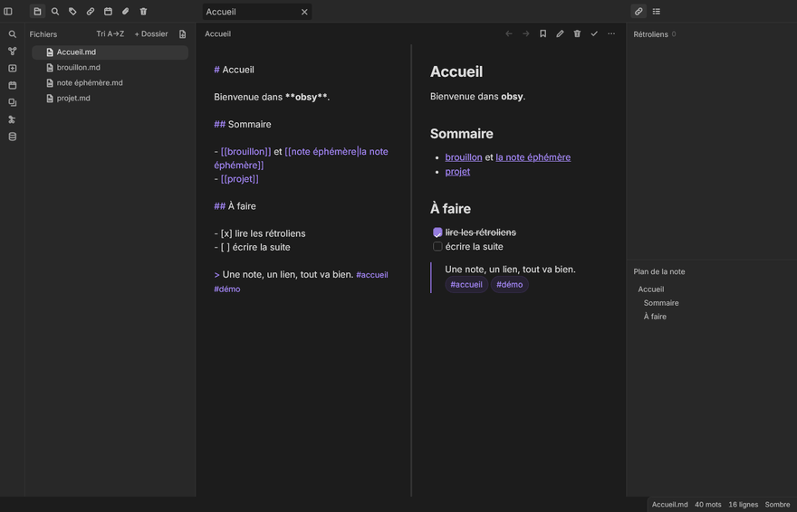

# obsy

Prise de notes locale pour coffres Markdown, écrite en Rust.
Wikilinks, graphe, rétroliens, recherche, thèmes — dans **22 Mo de mémoire**.



Réécriture indépendante, sans navigateur embarqué ni runtime tiers : un
processus, du Rust du moteur d'indexation au rendu. Le coffre reste un
dossier de fichiers Markdown, lisible par n'importe quel autre outil.

## Mémoire mesurée

| Contexte | obsy | Obsidian (Electron) |
|---|---|---|
| Interface native, au repos | **22 Mo** | 180 à 250 Mo (rapporté) |
| Interface native, coffre de 5 000 notes | **71 Mo**, sans pic | — |
| Interface web fidèle (moteur HTML) | **127 Mo** | — |

Mesures RSS d'un processus complet, rendu logiciel, protocole reproductible :
[`docs/BENCHMARKS.md`](docs/BENCHMARKS.md).

## Fonctionnalités

- **Coffre** : scan récursif, frontmatter YAML, tags, aliases,
  rétroliens/liens sortants, opérations atomiques confinées au coffre,
  corbeille, import/export `.zip`, snapshots.
- **Édition** : éditeur avec coloration de la source (18 types de
  fragments), aperçu live (titres, listes imbriquées, tâches, tableaux,
  callouts, tags), propriétés éditables, sauvegarde atomique,
  multi-onglets avec tampons non sauvegardés préservés.
- **Navigation** : sélecteur rapide (Ctrl+K, recherche approximative,
  notes récentes), palette de commandes (Ctrl+P), recherche globale avec
  opérateurs (`path:`, `tag:`, `line:`, exclusion) et remplacement,
  recherche dans la note (Ctrl+F).
- **Graphe** : force-dirigé interactif, zoom et déplacement, nœuds
  colorés par dossier, glisser-déposer, vues complète et locale.
- **Organisation** : calendrier mensuel avec notes quotidiennes,
  modèles (`{{title}}`, `{{date}}`), signets, notes récentes.
- **Export** : PDF, publication en site statique avec liens internes et
  rétroliens par page, export du coffre.
- **Apparence** : thèmes clair et sombre, polices et icônes embarquées
  (Inter, Lucide), panneaux redimensionnables persistés.
- **Moteur** : service HTTP local (`/files`, `/search`, `/graph`,
  `/backlinks`, `/metadata`, `/sync` — 23 opérations) avec confinement
  des chemins ; le même moteur alimente les deux interfaces.

Les raccourcis suivent les conventions d'Obsidian et sont remappables
via `hotkeys.json`.

## Installer

Binaires Linux (x64), macOS (x64, arm64) et Windows (x64) sur la page
[Releases](https://github.com/j0ltdevv/obsidian-rs/releases).

Depuis les sources (Rust 1.75+) :

```sh
cargo build --release --bin obsy
./target/release/obsy
```

L'application démarre sur un coffre de démonstration ; pointez-la vers
votre dossier de notes Markdown existant.

## Architecture

```
src/vault/    coffre : scan, index, liens, thèmes, export (testable, sans UI)
src/engine/   moteur HTTP : API REST + pont /sync confiné
src/ui/       interface native iced (22 Mo)
src/app/      état et entrées/sorties de l'interface native
web/          interface web (127 Mo avec un moteur HTML embarqué)
```

Documentation : [`docs/ARCHITECTURE.md`](docs/ARCHITECTURE.md),
[`docs/MANUEL.md`](docs/MANUEL.md), feuille de route
[`docs/ROADMAP-PARITE.md`](docs/ROADMAP-PARITE.md).
Site de présentation : [`site/index.html`](site/index.html).

## Périmètre

Le cœur local est couvert. Ne sont pas livrés : la synchronisation
multi-appareils, les greffons tiers JavaScript/CSS d'Obsidian,
l'application mobile — ils demandent des choix d'architecture dédiés
(moteur JS embarqué, protocole de synchronisation).

## Licence

MIT. Polices et icônes embarquées sous leurs licences respectives
(Inter OFL, Lucide ISC), détail dans [`THIRD-PARTY.md`](THIRD-PARTY.md).
